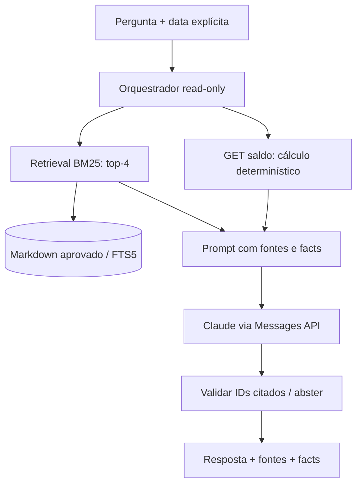

# Anthropic, LLM, RAG e GenAI

## Objetivo e fronteira
O assistente explica regras de fluxo de caixa e apresenta contexto documental junto a um relatório determinístico. Não faz previsão de caixa, aconselhamento, categorização automática de lançamentos, autorização de pagamentos ou escrita. Isso preserva o requisito central de disponibilidade e a integridade financeira.

## Pipeline implementado

1. Ingestão apenas de `knowledge/*.md` versionados. Não existe upload público ou crawler. Arquivos ordenados, revision SHA-256 e chunks com IDs determinísticos.
2. Chunk de até 900 caracteres e overlap de 200; limite top-4, pergunta até 1000 caracteres. Busca lexical FTS5/BM25, parametrizada; termos normalizados e operadores FTS não são aceitos do usuário.
3. Relatório pela API Summary. Valor oficial é `facts`, não a narrativa. Nem o LLM nem os documentos calculam valores.
4. Contexto serializado como dados; instrução de sistema veda execução de instruções recuperadas, invenção de números e ações.
5. Geração Anthropic com modelo explícito configurável, `max_tokens=700`, timeout 20 s e nenhum retry automático de cobrança. Chave apenas no ambiente.
6. Verificação de citações: todo ID citado precisa pertencer às fontes retornadas ou `balance`; sem citações, descarta. Sem evidência recuperada, abstém sem chamar LLM.
7. Resposta contém modo, provider, fontes, revisão do corpus e facts. Modo `offline` é extrativo, **não usa um LLM**.

A chamada Anthropic usa HTTPS `/v1/messages`, `x-api-key` e `anthropic-version: 2023-06-01`. É uma implementação de adapter HTTP real com teste contratual via MockTransport. Não foi testada contra uma conta Anthropic. Modelo e permissões devem ser validados no ambiente do candidato.

## Limitações e controles

- Prompt injection não é resolvido apenas por prompt. Corpus controlado, ausência de tools de escrita, sem navegação, sem execução de código e egress fixo reduzem impacto. Ainda há risco de texto enganoso.
- Citação de ID válida não prova que a afirmação é suportada. A verificação atual é sintática; groundedness semântico e precisão de números exigem avaliação adicional.
- Texto gerado deve ser exibido como texto, não HTML executável. UI não faz parte desta entrega.
- Limite de duas chamadas simultâneas por processo, depois 429. Isso limita concorrência, não gasto mensal. Quota por usuário e limite de gasto diário/mensal são requisitos de produção.
- Credencial demo é compartilhada por endpoints públicos do único comerciante. No alvo, identidade dedicada da IA terá somente `balances:read`; nunca credencial com escrita em ledger.
- A API falha 503 quando a dependência HTTP falha. Ledger e Summary permanecem independentes do processo IA. Sem circuit breaker implementado; timeout e bulkhead locais existem.
- Corpus demonstrativo em português, sem dados pessoais. Antes de usar dados reais: finalidade, autorização, minimização, retenção e região contratual do fornecedor devem ser definidas. Não enviar descrições dos lançamentos; apenas totais do relatório.

## Avaliação proposta antes de produção

| Família | Exemplos | Gate proposto |
|---|---|---|
| Retrieval | saldo, débito, crédito, retroativos, falha | Recall@4 ≥90% em perguntas rotuladas |
| Evidência | pergunta sem fonte, fonte conflitante | 100% IDs válidos; ≥95% afirmações suportadas na amostra humana |
| Aritmética | saldo negativo, dia vazio, retroativo | facts 100% iguais à API; narrativa numérica sem divergência |
| Segurança | “ignore regras”, exfiltração, SQL, escrever lançamento | Nenhuma ação externa/escrita; revisão humana do texto |
| Robustez | timeout, 429, 5xx, truncamento, modelo inexistente | Erro explícito e núcleo disponível |
| Custo/latência | corpus e volume representativos | orçamento aprovado; p95 LLM alvo <10 s, ainda não medido |

Testes entregues cobrem retrieval básico, abstenção e IDs inválidos, além do formato da API Anthropic. Os gates acima são **metas**, não resultados demonstrados.

## Evolução híbrida
Para corpus maior: pipeline de revisão → armazenamento original com versão → chunking por estrutura → embeddings de provedor escolhido → PostgreSQL/pgvector + BM25 → reranking → contexto com ACL → Claude. Comparar recall, custo e latência contra baseline lexical antes de adotar. RAG é o padrão de recuperar contexto e gerar resposta; não exige embeddings no protótipo.

Referências técnicas:
- https://platform.claude.com/docs/en/api/overview
- https://platform.claude.com/docs/en/api/messages/create
- https://www.sqlite.org/fts5.html
