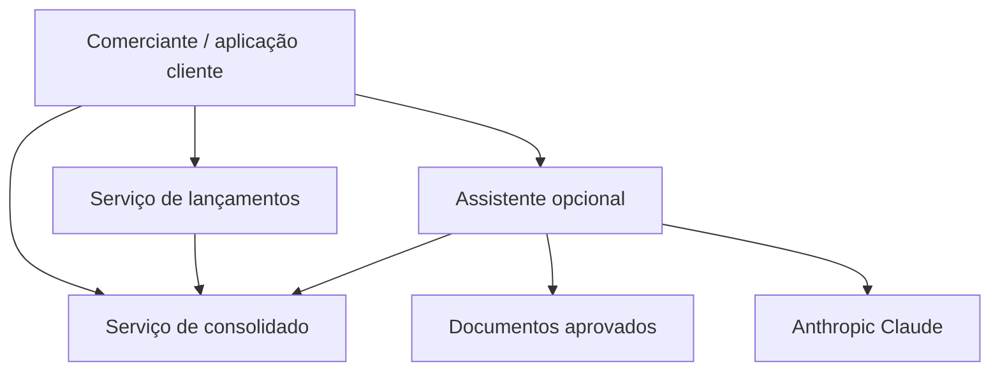
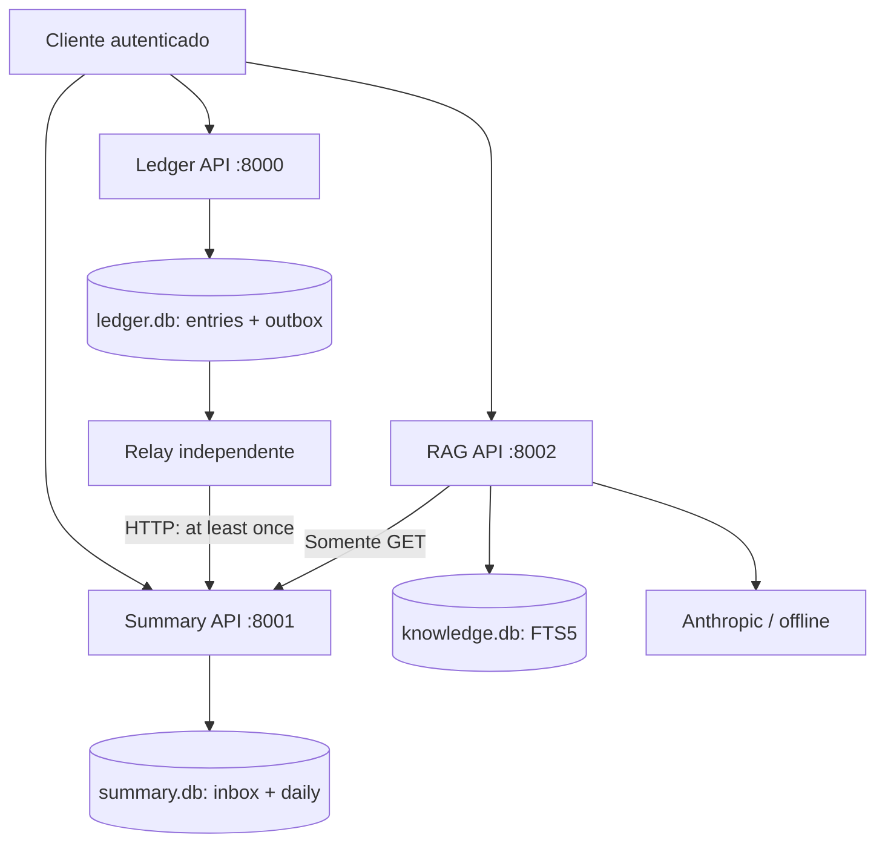
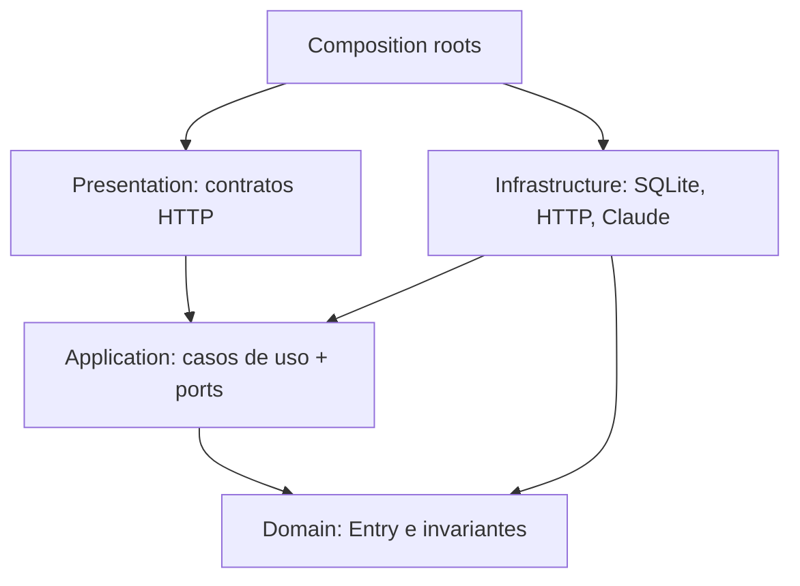
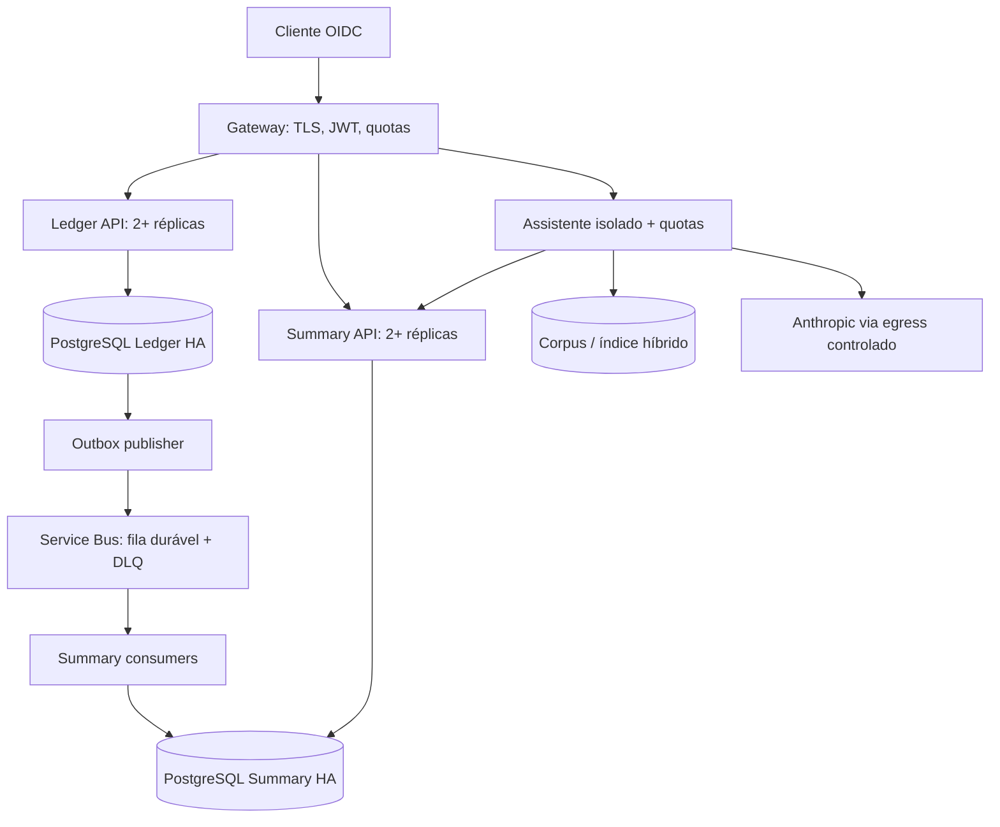

# Arquitetura

## Contexto e capacidades

| Domínio | Capacidade | Dono dos dados | Interface |
|---|---|---|---|
| Lançamentos | Registrar movimentações e impedir repetição | Ledger | REST commands + EntryRecorded v1 |
| Consolidação | Projetar totais diários e saldo acumulado | Summary | Eventos + REST queries |
| Conhecimento/assistência | Explicar regras e dados consolidados | Corpus aprovado | RAG read-only |
| Operação e identidade | Monitorar, autenticar, recuperar | Plataforma | Probes, logs, gateway alvo |



A ligação lançamentos→consolidado representa eventos assíncronos, não chamada na requisição do cliente. Claude só é chamado quando explicitamente configurado.

## Containers locais — implementados



Duas persistências transacionais distintas; o relay pertence ao domínio Ledger e acessa exclusivamente seu banco. Summary nunca acessa ledger.db. Relay isolado em processo evita que DNS/timeouts do consolidado afetem workers HTTP de escrita. SQLite WAL e timeout de lock de 5 s: adequado à demonstração em host único, um escritor por banco por vez. Não existe disponibilidade independente de host nesta topologia.

## Clean Architecture — componentes



Dependências de código apontam para as políticas de negócio. Os ports são Protocols estruturais; frameworks ficam fora do domínio. Teste AST impede importações invertidas no núcleo. São poucas abstrações por fronteira real, sem camadas de mapeamento redundantes.

## Sequência de registro e projeção

```mermaid
sequenceDiagram
  participant U as Cliente
  participant L as Ledger
  participant D as Ledger DB
  participant R as Relay
  participant S as Summary
  U->>L: POST + Idempotency-Key
  L->>D: BEGIN; entry + outbox; COMMIT
  D-->>L: Gravado
  L-->>U: 201 + entry.id
  R->>D: Ler eventos pendentes
  R->>S: EntryRecorded v1
  S->>S: Inbox + daily na mesma transação
  S-->>R: 200 (novo ou duplicado)
  R->>D: Marcar entregue
```

Se houver queda entre commit da projeção e confirmação, o relay reenvia; o mesmo ID não aplica novamente. A garantia é entrega pelo menos uma vez com efeito idempotente, não transporte exactly-once. Requisição não confirmada deve ser repetida pelo cliente com a mesma chave. O evento usa ID do lançamento; alteração do conteúdo com mesmo ID é conflito e quarentena.

## Arquitetura alvo — proposta de produção



Referência Azure pela integração com identidades e operação, sem acoplar domínio ao provedor. Containers em plataforma gerenciada; PostgreSQL separado por domínio; Service Bus com confirmação somente após commit. APIs escalam por CPU/latência, consumidores por idade da fila e taxa de chegada. Ledger não recebe health check transitivo de Summary, broker ou IA. Publicador usa lease/claim (`FOR UPDATE SKIP LOCKED` no adapter futuro); múltiplos publicadores atuais podem duplicar trabalho, mas não saldos. Escalar apenas depois de implementar adapter e testar concorrência real.

A fila absorve indisponibilidade; a Outbox absorve indisponibilidade do broker. Retenção e capacidade devem cobrir a duração de falha planejada. Alerta antes de esgotar disco. `daily` é projeção reconstruível do ledger; o ledger é fonte de verdade. Datas retroativas exigem recalcular saldos seguintes; nesta implementação opening usa soma dos dias anteriores, sem cache obsoleto.

## Trade-offs

- Dois serviços justificam independência de falha; um monólito modular com jobs também seria suficiente em menor escala, mas aumenta falha compartilhada.
- HTTP relay reduz infraestrutura local; broker melhora absorção, fan-out e isolamento operacional no alvo, com custo adicional.
- CQRS separa escrita/projeção, sem Event Sourcing: ledger relacional imutável é fonte primária; Outbox é mecanismo de entrega.
- Sem Redis inicialmente: 50 req/s não justifica cache sem medição. Cache futuro precisa invalidar datas afetadas por lançamentos retroativos.
- Sem Kubernetes obrigatório: plataforma gerenciada reduz operação. Não adicionar microsserviços por tabela.
- IA é diferencial explicativo. O requisito de 50 req/s aplica-se ao consolidado, nunca às chamadas LLM.
