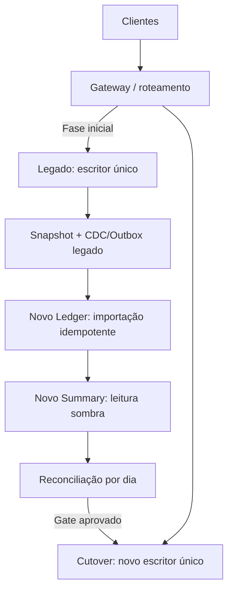

# Arquitetura de transição — se houver legado

Não há legado identificado no enunciado. Esta proposta é condicional; não inventa sistema existente.

1. **Descoberta:** inventariar fontes, moeda, timezone, estornos, IDs, datas de fechamento e SLA. Definir owner da reconciliação e critérios de parada.
2. **Snapshot consistente:** capturar high-water mark; importar histórico com ID estável derivado de sistema+ID legado e chave de importação única. Saldo de abertura explicitamente aprovado. Preservar datas e trilha de origem. API/importador legado ainda não implementado.
3. **Captura de mudanças:** CDC ou Outbox no legado desde watermark. Evitar dual-write não transacional. Duplicatas esperadas, tratadas pela idempotência. Ordenação não afeta somas; eventos de edição legada precisam de tradução para reversão/novo lançamento previamente modelada.
4. **Shadow:** novo consolidado recebe eventos e compara totais/contagem por dia com legado; não atende usuário como fonte oficial. Investigar toda divergência, não aceitar tolerância monetária artificial.
5. **Cutover:** congelar temporariamente escrita, drenar até watermark, reconciliar, transferir posse da escrita e trocar roteamento. Somente um escritor autoritativo. Pode haver janela curta planejada.
6. **Rollback:** antes de aceitar novas escritas, basta voltar roteamento. Depois de novas escritas, reverter exige importar delta de volta e reconciliar; não fazer simples troca de endpoint.
7. **Desativação:** manter histórico auditável e acesso somente leitura pelo prazo definido. Validar backup/restore e treinamento operacional antes de remover legado.

**Gates:** zero divergência de saldo e contagem; 50 req/s ≤5% erro no ambiente alvo; failover/restore ensaiados; alarmes ativos; owners e runbook aprovados. Não foi executada migração real.
